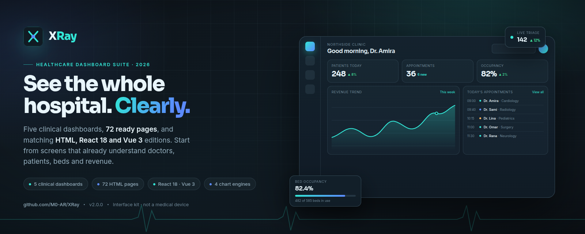
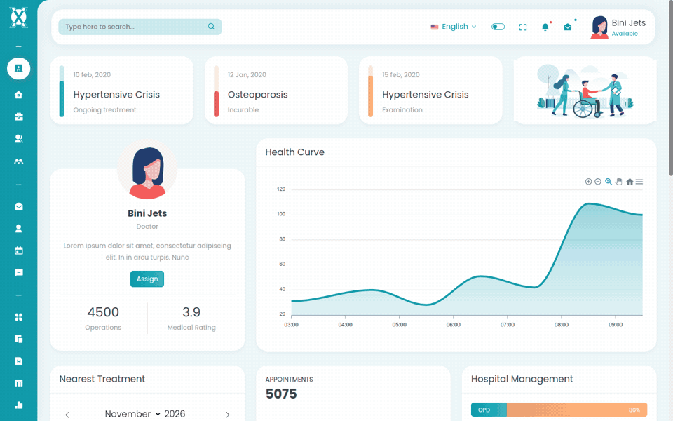
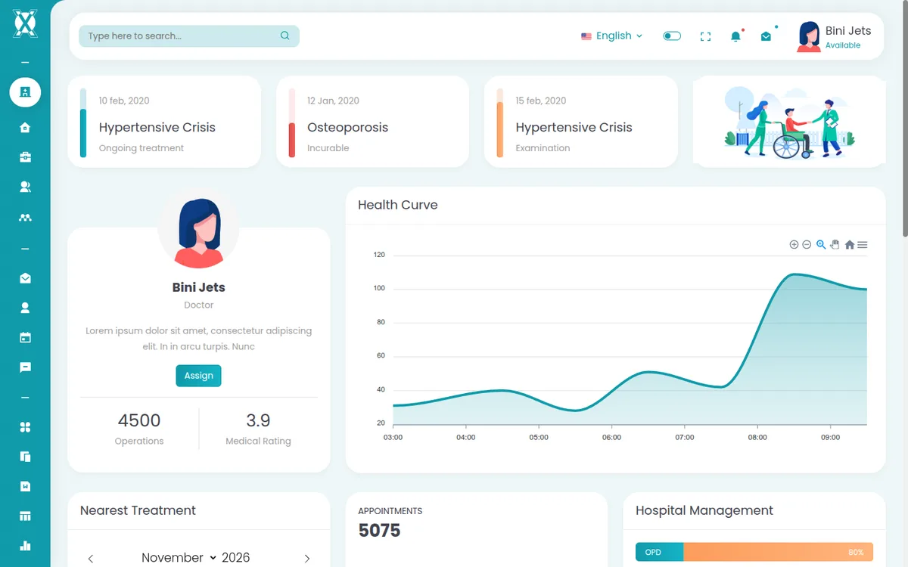
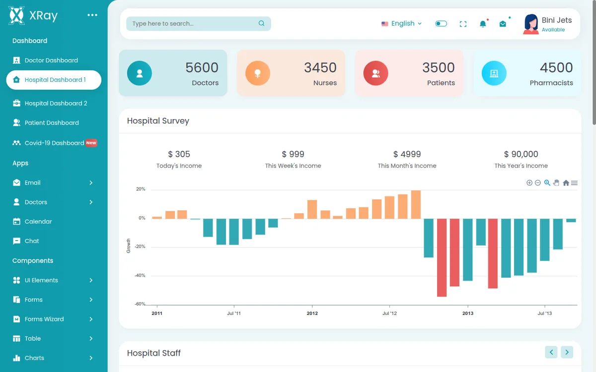
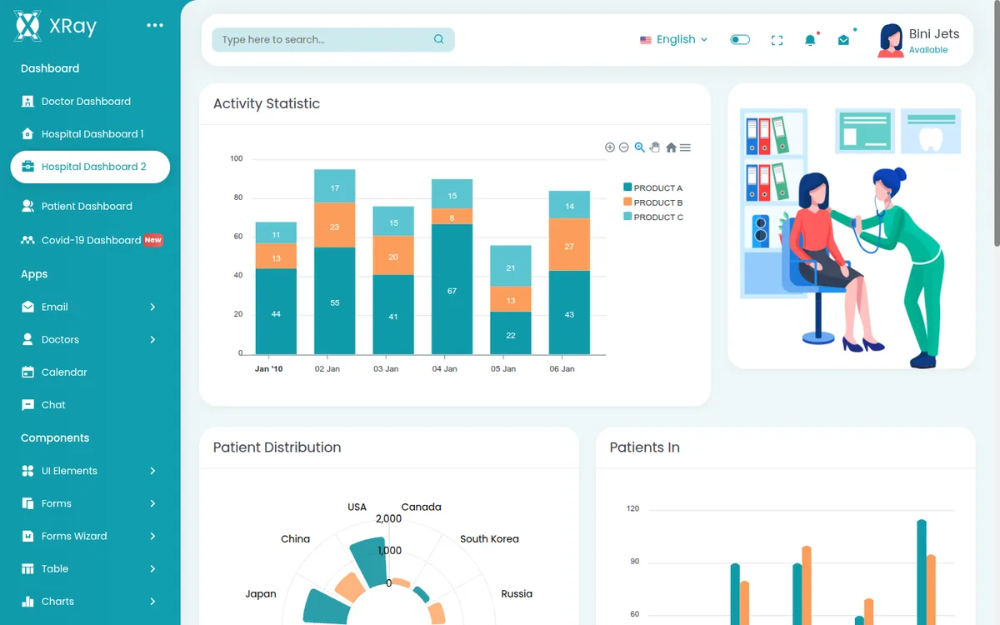
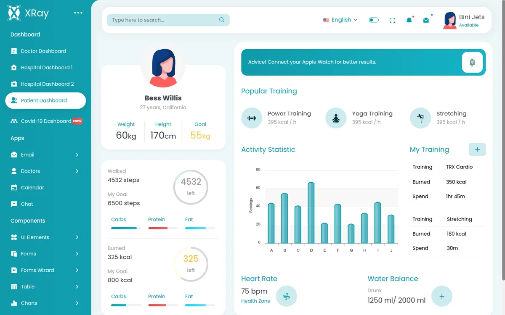
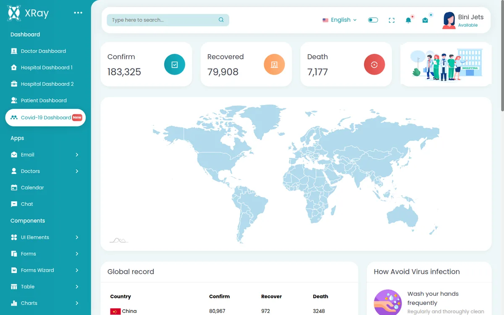
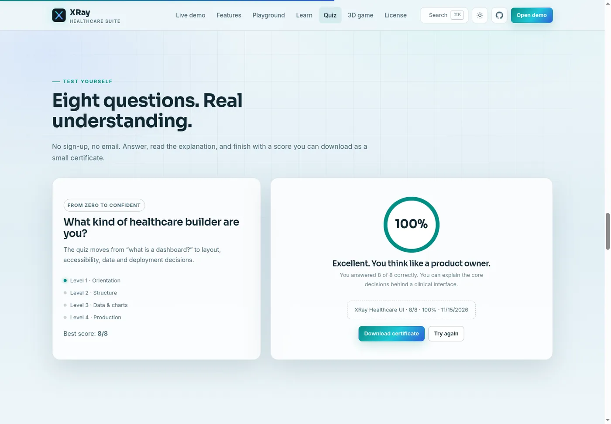

<p align="center">
  <a href="https://m0-ar.github.io/XRay/">
    
  </a>
</p>

<p align="center">
  <a href="https://m0-ar.github.io/XRay/"></a>
  <a href="html/"></a>
  <a href="react/"></a>
  <a href="vue/"></a>
  <a href="LICENSE"></a>
</p>

<h1 align="center">See the whole hospital. Clearly.</h1>

<p align="center">
  <strong>XRay is a complete healthcare dashboard suite: five clinical dashboards, 72 top-level HTML pages, and matching React 18 and Vue 3 editions.</strong><br>
  It gives a healthcare product the screens it needs before the first sprint — patients, doctors, appointments, beds, revenue and outbreaks — so your team can spend its time on the work only you can do.
</p>

<p align="center">
  <a href="https://m0-ar.github.io/XRay/"><strong>Open the live preview →</strong></a>
  &nbsp;·&nbsp;
  <a href="https://m0-ar.github.io/XRay/html/index.html">Browse the HTML demo</a>
  &nbsp;·&nbsp;
  <a href="docs/GETTING-STARTED.md">Get started</a>
  &nbsp;·&nbsp;
  <a href="https://github.com/M0-AR/XRay/releases">Download v2.0.0</a>
</p>

<p align="center">
  
</p>

<p align="center">
  <sub>Four of the five dashboards, then the interactive preview and the 3D learning game. Every screen shown is included in this repository.</sub>
</p>

<p align="center">
  <strong>5</strong> clinical dashboards &nbsp;·&nbsp;
  <strong>72</strong> HTML pages &nbsp;·&nbsp;
  <strong>3</strong> editions &nbsp;·&nbsp;
  <strong>4</strong> chart engines &nbsp;·&nbsp;
  <strong>5</strong> icon families &nbsp;·&nbsp;
  <strong>7</strong> Vue locale files &nbsp;·&nbsp;
  <strong>RTL</strong> included
</p>

---

**Contents**

- [What is XRay?](#what-is-xray)
- [The five dashboards](#the-five-dashboards)
- [Screenshots](#screenshots)
- [Every feature explained](#every-feature-explained)
- [🌱 Beginner guide](#beginner-guide)
- [Who it is for](#who-it-is-for)
- [Tech stack](#tech-stack)
- [Repository map](#repository-map)
- [Quick start](#quick-start)
- [Make it yours](#make-it-yours)
- [Deployment](#deployment)
- [Security, privacy and clinical safety](#security-privacy-and-clinical-safety)
- [Accessibility](#accessibility)
- [Performance](#performance)
- [FAQ](#faq)
- [Roadmap](#roadmap)
- [License](#license)
- [Contact](#contact)
- [Credits](#credits)

---

## What is XRay?

A hospital does not need another generic admin template. It needs screens that already understand the domain: a doctor's morning list, a ward's occupancy, a patient's history, a clinic's revenue, an outbreak's trend.

XRay is that starting point. It is a full interface suite for healthcare products, built three times — once in plain HTML and Bootstrap 5, once in React 18, and once in Vue 3 — with the same visual language and the same page set. The HTML edition is the largest: 72 top-level pages, from five different dashboards to forms, tables, charts, mail, chat, calendar, authentication and account screens.

The goal is simple: **let a team open a real healthcare interface on day one**, then replace the demo data, connect the API and make it theirs. It is a foundation for products and prototypes, not a finished medical record system.

| XRay is | XRay is not |
| --- | --- |
| A healthcare-focused interface kit | A medical device or clinical decision system |
| Five dashboard designs and a 72-page HTML library | A hosted EHR or hospital information system |
| Three separate, working framework editions | A backend, database or authentication service |
| A commercial template with a written licence path | A free-for-any-use open-source project |
| Realistic demo data and interaction patterns | Real patient data, real integrations or compliance certification |

> **Status:** version 2.0.0. The repository is public so you can evaluate the work. Production use requires a commercial licence — see [License](#license).

---

## The five dashboards

Each dashboard is a different answer to a different question. They are not five colour variations of one screen.

| # | Dashboard | The question it answers | Open it |
| --- | --- | --- | --- |
| 1 | **Doctor** | *What does my day look like, and who needs attention?* Daily clinical overview with appointments, patients, messages and activity. | [Live](https://m0-ar.github.io/XRay/html/index.html) · [Source](html/index.html) |
| 2 | **Hospital 1** | *How is the hospital performing right now?* Operational overview for a hospital: activity, revenue, patients, wards and schedules. | [Live](https://m0-ar.github.io/XRay/html/dashboard-1.html) · [Source](html/dashboard-1.html) |
| 3 | **Hospital 2** | *Where are patients coming from, and how satisfied are they?* Analytics-heavy layout with activity statistics, patient distribution map, satisfaction breakdown, tasks, timeline, patient list and reports. | [Live](https://m0-ar.github.io/XRay/html/dashboard-2.html) · [Source](html/dashboard-2.html) |
| 4 | **Patient** | *What is happening with this patient's health?* A patient-centred view with health metrics, appointments, reports and history. | [Live](https://m0-ar.github.io/XRay/html/dashboard-3.html) · [Source](html/dashboard-3.html) |
| 5 | **COVID-19** | *How is the outbreak trending?* Public-health surveillance layout with global and regional indicators, maps and trend charts. | [Live](https://m0-ar.github.io/XRay/html/dashboard-4.html) · [Source](html/dashboard-4.html) |

The React and Vue editions include the same five dashboard concepts as separate view components, with their own routing and state management.

---

## Screenshots

<table>
  <tr>
    <td width="50%">
      <a href="https://m0-ar.github.io/XRay/html/index.html"></a>
      <p align="center"><sub><strong>Doctor</strong> · <a href="html/index.html">open</a></sub></p>
    </td>
    <td width="50%">
      <a href="https://m0-ar.github.io/XRay/html/dashboard-1.html"></a>
      <p align="center"><sub><strong>Hospital 1</strong> · <a href="html/dashboard-1.html">open</a></sub></p>
    </td>
  </tr>
  <tr>
    <td width="50%">
      <a href="https://m0-ar.github.io/XRay/html/dashboard-2.html"></a>
      <p align="center"><sub><strong>Hospital 2</strong> · <a href="html/dashboard-2.html">open</a></sub></p>
    </td>
    <td width="50%">
      <a href="https://m0-ar.github.io/XRay/html/dashboard-3.html"></a>
      <p align="center"><sub><strong>Patient</strong> · <a href="html/dashboard-3.html">open</a></sub></p>
    </td>
  </tr>
  <tr>
    <td width="50%">
      <a href="https://m0-ar.github.io/XRay/html/dashboard-4.html"></a>
      <p align="center"><sub><strong>COVID-19</strong> · <a href="html/dashboard-4.html">open</a></sub></p>
    </td>
    <td width="50%">
      <a href="https://m0-ar.github.io/XRay/html/index.html"></a>
      <p align="center"><sub><strong>Interactive preview</strong> · <a href="https://m0-ar.github.io/XRay/preview.html">open</a></sub></p>
    </td>
  </tr>
</table>

<p align="center"><sub>All screenshots are captured from this repository. The preview also has a dark theme, a 3D hero and a learning game.</sub></p>

---

## Every feature explained

### The page library at a glance

The HTML edition contains **72 top-level pages**. Every page below can be opened from the demo sidebar; the email app adds three more screens inside `html/app/`, for 75 HTML screens in total.

| Group | Pages | What you get |
| --- | ---: | --- |
| Clinical dashboards | 5 | Doctor, Hospital 1, Hospital 2, Patient, COVID-19 |
| Charts | 4 | Dedicated chart pages for ApexCharts, amCharts and ECharts, plus the main charts page |
| Forms and wizards | 8 | Layout, checkbox, radio, switch, validation, horizontal wizard, validated wizard, vertical wizard |
| Tables | 3 | Basic tables, data table, editable table |
| Icons | 5 | Font Awesome 5, Remix Icon, Unicons, Line Awesome, Dripicons |
| UI elements | 20 | Alerts, badges, breadcrumbs, buttons, cards, carousels, colours, dropdowns, video embeds, grid, images, list groups, modals, notifications, pagination, popovers, progress bars, tabs, tooltips, typography |
| Apps | 2 | Chat and calendar, plus three additional email screens in `html/app/` (inbox, read/list, compose) |
| Authentication | 4 | Sign in, sign up, recover password, lock screen |
| Utility and account | 21 | 404, 500, maintenance, coming soon, confirm mail, FAQ, invoice, pricing ×2, timeline, map, privacy policy, privacy settings, terms, profile, edit profile, account settings, blank page, doctor list, add doctor, vector map |
| **Total** | **72** | Top-level pages; `html/app/` adds three email screens (75 screens in total) |

### Dashboard building blocks

Depending on which dashboard you open, you will find:

- **KPI cards** for patients, appointments, revenue, occupancy and other daily numbers.
- **Line, area, bar, donut and radial charts** for trends, comparisons and proportions.
- **Patient distribution maps** and vector maps for regional views.
- **Appointment and patient tables** with search, sorting, pagination and status styling.
- **Patient satisfaction breakdowns** with progress bars and percentage tables.
- **Clinical timelines** for admission, treatment and discharge events.
- **Task lists, notifications and message panels** for daily work.
- **Report lists** with download, view and on-hold states.
- **Ward, bed and staff widgets** in the hospital layouts.

The React and Vue editions rebuild these patterns as components instead of static markup.

### Four chart engines

XRay bundles four chart libraries so you can standardise on the one your team already knows:

| Engine | Where it is used |
| --- | --- |
| **ApexCharts** | Dedicated Apex chart page and several dashboard charts |
| **Chart.js** | Bundled on the charts page |
| **ECharts** | Dedicated ECharts page and data-heavy visualisations |
| **amCharts** | Dedicated amCharts page and map/statistics layouts |

Each engine has its own strengths. Keeping all four in the repository lets you compare behaviour, then remove the ones you do not need before production.

### Five icon families

Every icon page is a searchable visual reference:

1. **Font Awesome 5**
2. **Remix Icon**
3. **Unicons**
4. **Line Awesome**
5. **Dripicons**

Use one family for consistency, or mix them where a product needs a specific glyph.

### Forms, tables and wizards

- **Forms:** layouts, checkboxes, radios, switches and validation states.
- **Wizards:** horizontal, validated and vertical variants — useful for patient intake, admissions and onboarding.
- **Tables:** a basic table, a data table and an editable table. Sorting, search, pagination and inline editing patterns are demonstrated with demo data.
- **Calendar:** a FullCalendar-based scheduling screen.
- **Chat:** a two-pane conversation layout.
- **Email:** inbox, read/list and compose screens.

### Authentication and utility pages

The authentication screens are **interface demos**, not a working auth system. They include sign in, sign up, password recovery and a lock screen, ready to be connected to your own identity provider.

The utility set covers the pages real products forget until launch week: 404 and 500 errors, maintenance, coming soon, confirm mail, FAQ, invoice, two pricing layouts, timeline, map, privacy policy, privacy settings, terms of service, profile, edit profile, account settings and a blank page.

### Three framework editions

| Edition | Stack | Files | Start it with |
| --- | --- | --- | --- |
| **HTML** | Bootstrap 5, jQuery, bundled chart and icon libraries | **72 top-level pages** | Any static server |
| **React** | React 18.2, React Router 6.17, Redux Toolkit, React-Bootstrap, Sass | **73 view files** | `npm start` |
| **Vue** | Vue 3.3, Vue Router 4, Pinia, Vue I18n, BootstrapVue 3 | **80 view components** | `npm run serve` |

The three editions are **separate implementations**, not one codebase compiled three ways. They share the design language and page set, but small differences exist. Check the exact screen you need in the edition you plan to ship.

### Layout, RTL and localisation

- **Responsive layouts** with collapsible sidebars and mobile-friendly tables.
- **RTL support** in all three editions: Bootstrap RTL stylesheets and a `style-rtl.css` file ship with the project. The HTML and Vue layouts include an RTL switch.
- **Vue locale files** for seven languages: `ar`, `chi`, `en`, `fr`, `gr`, `hi`, `sp` (file names as shipped). The HTML and React editions are English-only by default; the structure is ready for your own translation layer.
- **Light interface** by default. Dark-mode logo and loader artwork is included in the React and Vue asset libraries, but the dashboards themselves ship light-themed. The interactive preview has its own dark/light theme.

### The interactive preview (`preview.html`)

The repository includes a separate presentation and learning page at [`preview.html`](preview.html). It is **not part of the product UI**; it is a guided tour you can publish alongside the demo.

- A 3D DNA-helix hero built with Three.js (vendored locally, no CDN required).
- Live demo tabs that load the four main dashboards in an embedded browser frame.
- A searchable feature finder and a dashboard configurator.
- A simple ROI calculator with editable assumptions.
- A five-step beginner path with local progress saved in your browser.
- An eight-question healthcare interface quiz with explanations and a saved result.
- **Build the clinical brain** — a small 3D neural-network game with optional speech narration, keyboard-friendly answer buttons, score and best-score memory.
- A command palette (`Ctrl`/`Cmd` + `K`), dark/light theme and reduced-motion support.

It requires no build step. Open it from a local server, or use the live preview.

### Documentation, checks and Docker

- [`docs/`](docs/) contains the getting-started, customisation, deployment, FAQ and security notes.
- [`docs/workflows/verify.yml`](docs/workflows/verify.yml) and [`docs/workflows/docker-publish.yml`](docs/workflows/docker-publish.yml) are ready-to-use GitHub Actions definitions for file checks and for publishing a static demo image. Copy them into `.github/workflows/` to enable them.
- The included `Dockerfile` serves the preview and the HTML demo with nginx. It does not build the React or Vue editions.

---

<a id="beginner-guide"></a>
## 🌱 Beginner guide | Read this and you are a professional

Never shipped a dashboard before? Start here. No prior healthcare knowledge is assumed.

### 1. What is a dashboard, really?

A dashboard is a screen that answers a small number of questions quickly. It is not a database viewer and it is not a report. A good clinical dashboard answers questions such as:

- Who needs attention right now?
- What changed since the last shift?
- Where is the pressure building — beds, staff, waiting times, revenue?
- What is the next action, and who owns it?

Every design decision in XRay follows from those questions. When you customise it, keep asking them.

### 2. Learn five words

| Word | Meaning in this project |
| --- | --- |
| **KPI** | A key performance indicator — one number that matters, such as occupancy or appointments today. |
| **Chart engine** | The JavaScript library that draws a chart: ApexCharts, Chart.js, ECharts or amCharts. |
| **SPA** | Single-page application — the React and Vue editions. Navigation happens without full page reloads. |
| **RTL** | Right-to-left layout, used by Arabic, Hebrew and other languages. |
| **Demo data** | Sample names, numbers and dates that make the screens look real. None of it is patient data. |
| **Build step** | A command that turns source files into files a browser can serve. The HTML edition has none; React and Vue do. |

### 3. Choose the edition that matches your skills

| If you… | Choose | Why |
| --- | --- | --- |
| Know HTML and CSS, or need a demo today | **HTML** | No install, no build, 72 top-level pages ready to open. |
| Build products in React | **React** | Components, routing and Redux state. |
| Build products in Vue | **Vue** | Components, routing, Pinia and locale files. |
| Are not sure | **HTML first** | It is the fastest way to understand the screens, then port the patterns. |

### 4. Open the HTML edition (2 minutes)

You need Python 3 or any static file server. From the repository root:

```bash
python3 -m http.server 8000
```

Then open **<http://localhost:8000/html/index.html>**.

Why a server instead of double-clicking the file? Some browsers block local scripts, maps and chart requests on `file://`. A local server removes that class of problem.

Click through the sidebar. Open each of the five dashboards. Resize the window to phone width. Try the RTL switch. That is the product.

### 5. Run the React edition (5–10 minutes)

```bash
cd react
npm install
npm start
```

Open **<http://localhost:3000>**. Use Node 18 or 20 LTS if your machine has a very new Node release and an older tool complains.

### 6. Run the Vue edition (5–10 minutes)

```bash
cd vue
npm install
npm run serve
```

Open **<http://localhost:8080>**. Run only one dev server at a time if port 8080 is already taken by the HTML server.

### 7. Change one thing (your first edit)

1. Open `html/index.html` in a code editor.
2. Find the heading that contains `Good morning` or the clinic name.
3. Replace it with your own words.
4. Save, refresh the browser. That is the whole loop.

You have now edited a production-quality dashboard. Everything else is the same loop with more context.

### 8. Publish it

The fastest route is a static host. Upload the `html/` folder, or push the repository to GitHub and enable Pages. Full instructions, including SPA fallbacks for React and Vue, are in [`docs/DEPLOYMENT.md`](docs/DEPLOYMENT.md).

### 9. Read a dashboard like a professional

When you open any screen, ask:

1. **Who is this for?** A doctor at 08:00, a ward manager at 14:00 and a finance lead on Friday need different screens.
2. **What is the first question?** The most important number belongs at the top, not in a modal.
3. **What is the next action?** A number without a decision attached is decoration.
4. **What happens on a bad day?** Empty states, errors, long names, missing data and slow networks matter more than the happy path.
5. **Can it be used under pressure?** Large targets, clear hierarchy, keyboard access, readable contrast and no reliance on colour alone.

### 10. Where to go next

- [Getting started](docs/GETTING-STARTED.md)
- [Customisation](docs/CUSTOMIZATION.md)
- [Deployment](docs/DEPLOYMENT.md)
- [FAQ](docs/FAQ.md)
- [Security, privacy and clinical safety](docs/SECURITY-AND-ACCESSIBILITY.md)

---

## Who it is for

| Audience | What XRay gives you | Start with |
| --- | --- | --- |
| **Hospitals and clinics** | A realistic internal admin interface to evaluate, prototype and adapt | HTML edition |
| **Health-tech startups** | A product shell that already speaks the domain, before the backend exists | React or Vue |
| **Agencies and studios** | A polished demo to show clients in days, not weeks | HTML edition |
| **Designers** | A reference for clinical hierarchy, tables, forms and dense data layouts | Preview and screenshots |
| **Educators and students** | A concrete, readable example of a real-world interface suite | Beginner guide above |
| **Researchers** | A reproducible UI artefact for studies and teaching; see `CITATION.cff` | Preview, docs and source |

**Typical use cases:** patient portals, clinic administration, hospital operations dashboards, appointment systems, billing and revenue views, public-health surveillance prototypes, design-system exploration and UI teaching.

---

## Tech stack

### HTML edition

- Bootstrap 5 and jQuery
- ApexCharts, Chart.js, ECharts and amCharts
- Font Awesome 5, Remix Icon, Unicons, Line Awesome and Dripicons
- FullCalendar, Flatpickr, Select2, Leaflet, Swiper, Owl Carousel and Magnific Popup
- RTL stylesheets and a layout-level RTL switch
- No build step and no backend required

### React edition

- React 18.2 and React Router 6.17
- Redux Toolkit and React Redux
- React-Bootstrap and Sass
- ApexCharts, Chart.js, ECharts and amCharts
- FullCalendar, Flatpickr, Leaflet, Swiper and more
- 73 view files and separate routers for app, auth and error pages

### Vue edition

- Vue 3.3 and Vue Router 4
- Pinia, Vue I18n 9 and BootstrapVue 3
- VeeValidate, FullCalendar and Leaflet
- ApexCharts, Chart.js, ECharts and amCharts
- 80 view components, RTL switch, dark-mode toggle and seven locale files

> **Compatibility note:** the editions were assembled with the dependency versions in their own `package.json` files. Use the Node version that those tools expect (Node 18 or 20 LTS is the safest starting point for a 2023-era React/Vue toolchain). The HTML edition has no Node requirement.

---

## Repository map

```text
XRay/
├── preview.html              # Interactive presentation, quiz and 3D learning game
├── index.html                # Styled redirect to preview.html for GitHub Pages
├── 404.html                  # GitHub Pages 404 page
├── html/                     # HTML edition: 72 top-level pages, all assets included
│   ├── index.html            # Doctor dashboard
│   ├── dashboard-1.html      # Hospital dashboard 1
│   ├── dashboard-2.html      # Hospital dashboard 2
│   ├── dashboard-3.html      # Patient dashboard
│   ├── dashboard-4.html      # COVID-19 dashboard
│   ├── app/                  # Email app pages
│   ├── css/ js/ images/      # Shared assets
│   └── ...                   # Charts, forms, tables, icons, UI, auth, utility
├── react/                    # React 18 edition (own package.json)
│   ├── public/
│   └── src/
│       ├── components/ layouts/ store/ views/ router/
│       └── assets/
├── vue/                      # Vue 3 edition (own package.json)
│   ├── public/
│   └── src/
│       ├── components/ layouts/ store/ views/ router/ locales/
│       └── assets/
├── assets/
│   ├── brand/                # Banner, logo and social preview artwork
│   ├── media/                # Tour GIF and preview screenshots
│   ├── screenshots/          # Five dashboard screenshots (PNG + WebP)
│   └── vendor/               # Vendored Three.js for the preview
├── docs/                     # Guides, FAQ, security notes and workflow templates
├── .github/                  # Issue templates and pull request template
├── Dockerfile                # nginx image for the static preview and HTML demo
├── docker/nginx.conf
├── CITATION.cff              # Citation metadata for research and teaching
├── CHANGELOG.md
├── LICENSE                   # Proprietary notice
└── package.json              # Root dev dependencies
```

---

## Quick start

### Before you start

- **HTML edition:** Python 3 (or any static server) and a browser.
- **React/Vue editions:** Node 18 or 20 LTS and npm.
- **No database, no API keys and no backend are required** for any edition. Every screen uses demo data.

Clone the repository once:

```bash
git clone https://github.com/M0-AR/XRay.git
cd XRay
```

### HTML edition

```bash
python3 -m http.server 8000
```

Open <http://localhost:8000/html/index.html>.

If you prefer another server, any static server works. The important part is that requests for `css/`, `js/` and `images/` resolve from the `html/` folder.

### React edition

```bash
cd react
npm install
npm start
```

Open <http://localhost:3000>.

Create a production build with:

```bash
npm run build
```

The build output is in `react/build/`.

### Vue edition

```bash
cd vue
npm install
npm run serve
```

Open <http://localhost:8080>.

Create a production build with:

```bash
npm run build
```

The build output is in `vue/dist/`.

### Troubleshooting

| Symptom | Likely cause | Fix |
| --- | --- | --- |
| Charts or maps are blank | Opened through `file://` | Serve the folder over HTTP |
| `npm install` fails on a brand-new Node version | Old toolchain expectations | Use Node 18 or 20 LTS |
| React shows a blank page | Wrong working directory or router base | Run from `react/`, check the browser console |
| Vue dev server uses a port you need | Default is 8080 | Stop the other server or pass a different port |
| Page styles look unstyled | Opened a page outside its folder | Start from `html/index.html` and use its links |

---

## Make it yours

### Replace the logo

| Edition | Files |
| --- | --- |
| HTML | `html/images/logo.png`, `logo-white.png`, `logo-full2.png`, `logo1.png` |
| React | `react/src/assets/images/logo.png`, `logo-white.png`, `logo-full2.png`, `logo1.png` |
| Vue | `vue/src/assets/images/logo.png`, `logo-white.png`, `logo-full2.png`, `logo1.png` |

Keep the same file names and dimensions where possible, then replace the favicon (`html/images/favicon.ico`) if you have one.

### Change the colours

- **HTML:** `html/css/style.css` and `html/css/developer.css`.
- **React:** `react/src/assets/scss/style.scss`.
- **Vue:** `vue/src/assets/css/style.css` and `vue/src/assets/css/developer.css`.

Search for the primary colour value in those files and replace it consistently. Charts often define their own colour arrays in the page scripts; update those too if you want charts to match.

### Change the navigation

- **HTML:** each page contains its own sidebar and header markup. Update the menu in the pages you keep, or generate it from a template.
- **React:** `react/src/components/partials/SidebarStyle/sidebar-menu.js` holds the sidebar menu data.
- **Vue:** the layout lives in `vue/src/layouts/Layout1.vue`, with routes in `vue/src/router/index.js`.

### Add a page

**HTML:** copy an existing page such as `html/blank-page.html`, keep its `css/` and `js/` links, change the title and content, and add a link in the sidebar.

**React:** add a view under `react/src/views/`, then register it in the router files under `react/src/router/`.

**Vue:** add a view under `vue/src/views/`, then add a route in `vue/src/router/index.js` and a sidebar entry in the layout.

### Replace the demo data

Every table, chart and list uses static sample data. Replace it at the source:

- HTML: edit the markup and the chart configuration in the page or its script.
- React: replace the data in the relevant view or component.
- Vue: replace the data in the relevant view component or Pinia store.

Do not put real patient data into a front-end repository, a demo build or browser storage.

### Fonts and translations

- Font imports and typography rules live in the stylesheets (`html/css/typography.css` and the framework style files).
- Vue translations live in `vue/src/locales/`. Add a locale file, then register it in `vue/src/i18n.js`.
- The HTML and React editions need your own translation layer if you ship multilingual content.

### Remove what you do not need

Delete unused pages and their sidebar links, then remove the chart or icon libraries you have standardised away from. Fewer assets means faster pages and a smaller review surface.

---

## Deployment

### GitHub Pages (this repository)

The repository is laid out for branch deployment from the `main` branch root:

| URL | What it serves |
| --- | --- |
| `/` | Styled redirect to `preview.html` |
| `/preview.html` | Interactive presentation and learning page |
| `/html/index.html` | Doctor dashboard and the full HTML demo |
| `/html/dashboard-1.html` … `dashboard-4.html` | The other four dashboards |

The `.nojekyll` file is present, so folders and assets are served as-is. GitHub Pages serves static files only; it does **not** run the React or Vue development servers.

### Any static host

Upload the `html/` folder to Netlify, Vercel, Cloudflare Pages, S3, nginx or any static host. The entry point is `html/index.html`. No server-side runtime is required.

### React and Vue

Build the edition, then deploy its output:

- React: `npm run build` → deploy `react/build/`.
- Vue: `npm run build` → deploy `vue/dist/`.

Both are single-page applications. Configure the host to rewrite unknown paths to `index.html`, otherwise a refresh on a nested route returns a 404.

### Docker

The included image serves the preview and the HTML edition; it does not build React or Vue.

```bash
docker build -t xray .
docker run --rm -p 8080:80 xray
```

Open <http://localhost:8080/> for the preview and <http://localhost:8080/html/index.html> for the demo.

---

## Security, privacy and clinical safety

XRay is an **interface template**. It is not a medical device, not an EHR, not a clinical decision-support system and not a certified compliance product.

- **No backend.** There is no database, no API, no session service and no patient data flow.
- **Demo data only.** Names, numbers and reports are sample content. Do not treat them as clinical information.
- **Authentication screens are UI demos.** They do not authenticate anyone. Connect your own identity provider, session handling and authorisation model.
- **No HIPAA, GDPR or WCAG certification.** Compliance depends on your whole system, your hosting, your contracts and your processes. The repository does not claim any certification.
- **Third-party libraries carry their own licences.** Review them before redistribution or commercial launch.

Before production, at minimum:

1. Replace all demo data and remove unused sample pages.
2. Add real authentication, role-based authorisation and audit logging.
3. Encrypt data in transit and at rest; define retention and deletion policies.
4. Add consent, privacy notices and jurisdiction-specific requirements.
5. Threat-model the front end: XSS, unsafe HTML injection, insecure storage, third-party scripts.
6. Run dependency and licence audits (`npm audit`, your organisation's tooling).
7. Clinically review every label, unit, threshold, alert and colour-coded state with real clinicians.
8. Test empty, error, slow and offline states — not only the happy path.
9. Conduct an accessibility audit with keyboard, screen-reader and contrast testing.
10. Never store patient data in `localStorage`, URLs or client-side logs.

To report a security issue, use the repository's **Security** tab and open a private advisory. Please do not publish exploit details in a public issue.

---

## Accessibility

The templates provide accessibility foundations, not a conformance certificate:

- Semantic Bootstrap markup and visible focus styles.
- Keyboard-operable menus, forms and modal patterns.
- RTL stylesheets in all editions, with layout-level RTL switches in the HTML and Vue editions.
- Reduced-motion support in the interactive preview.
- Responsive layouts down to phone width.

Before shipping, audit at least:

- Colour contrast in every state (default, hover, focus, disabled, error).
- Keyboard-only navigation and focus order.
- Screen-reader labels for icons, charts and status indicators.
- Target sizes for touch and for use under pressure.
- Charts that do not rely on colour alone; add labels, patterns or tables.
- Form errors that are announced, specific and recoverable.
- Zoom to 200% without loss of function.

Tools such as axe, Lighthouse and a real screen reader are a starting point. Real users with real tasks are the standard.

---

## Performance

- The HTML edition is static: each page loads only the CSS, JavaScript and chart library it needs.
- The interactive preview lazy-loads demo iframes, pauses its 3D scenes when they are off-screen, caps device pixel ratio at 2 and honours reduced-motion preferences.
- Three.js is vendored locally in `assets/vendor/` for the preview, so the 3D scene has no CDN dependency. Google Fonts are loaded from the network; system font fallbacks are defined.

For production:

1. Remove chart and icon libraries you do not use.
2. Self-host fonts and subset them.
3. Compress images and serve modern formats.
4. Set long-lived cache headers for static assets.
5. Measure with Lighthouse on the devices and networks your users actually have.

---

## FAQ

### Is XRay a medical device or an EHR?

No. It is an interface template for healthcare products. It does not diagnose, treat, prescribe or store patient records.

### Can I use it in a commercial product?

Production use requires a commercial licence. The public repository is for evaluation. Read [LICENSE](LICENSE) and contact the maintainer through GitHub to request terms.

### Is there a backend, database or API?

No. Every edition is front-end only and uses demo data. You connect your own services.

### Which edition should I choose?

Choose HTML for the fastest start and the largest page library. Choose React or Vue if your product already uses that framework. The visual language is shared, so you can prototype in HTML and rebuild in your framework.

### Are the three editions identical?

They share the design language and page set, but they are separate implementations with different component structures and small visual differences. Verify the exact screens you need in the edition you plan to ship.

### Does it support Arabic and RTL?

Yes for layout: Bootstrap RTL and `style-rtl.css` ship with all three editions, and the HTML and Vue layouts include an RTL switch. Vue also contains seven locale files. Translated medical content and locale-specific formatting still need your review.

### Why do the charts show sample numbers?

Because there is no backend. Replace the static data with your API responses; the chart configurations show the expected shape.

### Can I remove the XRay branding?

Under a commercial licence you can adapt the interface and remove attribution according to the written terms. The evaluation copy keeps its notices.

### Why is it called XRay?

Because the best dashboards make a complex system legible — you see through the noise to the structure underneath. It is a metaphor, not a radiology product.

### How do I report a bug or request a feature?

Open an issue with the templates in `.github/ISSUE_TEMPLATE/`. For licensing, use the same issue tracker and state that it is a licensing request. For security, use a private advisory.

---

## Roadmap

Planned work, not a promise of dates:

| Area | Intent |
| --- | --- |
| Build tooling | Add a modern Vite path for the React edition and document Node compatibility more precisely |
| Design tokens | Extract shared colours, spacing and type into a single token source used by all three editions |
| Accessibility | A documented audit pass and fixes across the core dashboards and forms |
| Theming | A complete, consistent dark theme across all editions, not only assets |
| Examples | A small typed API adapter example for React and Vue, with loading, empty and error states |
| Documentation | More screenshots, a page-by-page map and deployment recipes |

If you need one of these for a real project, say so in an issue; real needs shape the order.

---

## License

**Proprietary. Copyright 2020 XRay. All Rights Reserved.**

The repository is public so you can evaluate the work. Viewing and evaluating the code is permitted. Production use, redistribution, resale or inclusion in a commercial product requires a written commercial licence from the author. See [LICENSE](LICENSE) for the notice.

Third-party libraries, fonts, icons and artwork remain under their own licences. You are responsible for reviewing them for your distribution.

---

## Contact

- **Bugs and features:** [GitHub Issues](https://github.com/M0-AR/XRay/issues)
- **Licensing:** open an issue and mark it as a licensing request, or contact the maintainer through [GitHub](https://github.com/M0-AR)
- **Security:** use the repository's **Security** tab for a private advisory
- **Project:** [github.com/M0-AR/XRay](https://github.com/M0-AR/XRay)

No email address is published here; GitHub is the supported contact channel.

---

## Credits

XRay stands on the work of the open-source community: Bootstrap, React, Vue, ApexCharts, Chart.js, ECharts, amCharts, FullCalendar, Leaflet, Flatpickr, Select2, Swiper, Owl Carousel, Magnific Popup, Font Awesome, Remix Icon, Unicons, Line Awesome and Dripicons. The interactive preview uses Three.js, vendored locally. Fonts in the preview are served by Google Fonts.

All product names, logos and trademarks are the property of their respective owners. XRay is an independent interface kit and is not affiliated with any hospital, EHR vendor or standards body.

<p align="center"><sub>Built for the people who keep the hospital running — and for the teams who build the software they use.</sub></p>
